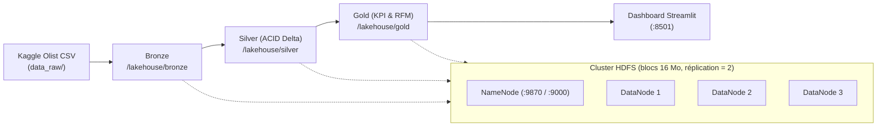

# TP Big Data Lakehouse — HDFS (3 DataNodes) + PySpark + Delta Lake + Streamlit

Environnement pédagogique complet reposant sur un **cluster HDFS réel distribué (1 NameNode + 3 DataNodes)** avec blocs réduits à **16 Mo** et détection de panne abaissée à **~50 secondes**, couplé à une image mutualisée légère (`python:3.11-slim-bookworm` + `uv` + JARs Delta pré-embarqués) pour **PySpark 3.5**, **Delta Lake 3.2**, **JupyterLab** et **Streamlit**.

Le fil rouge des 4 séances s'appuie sur le jeu de données réel **Olist Brazilian E-Commerce** (~100 000 commandes sur 9 tables relationnelles).



---

## Arborescence du dépôt

```text
.
├── .devcontainer/
│   └── devcontainer.json       # Connexion VS Code directe au conteneur spark-jupyter
├── .vscode/
│   ├── extensions.json         # Extensions recommandées (Python, Jupyter, Ruff, Docker, Task)
│   ├── launch.json             # Débogage PySpark & prévisualisation Streamlit (:8502)
│   ├── settings.json           # Kernel Python/Jupyter pré-configuré, Ruff & propreté éditeur
│   └── tasks.json              # Actions VS Code en 1 clic (Démarrer, Crash-test, Tests...)
├── docker-compose.yml          # Cluster HDFS (1 NN + 3 DN) + JupyterLab + Streamlit
├── Taskfile.yml                # Orchestration go-task (démarrage, crash-test, tests J1..J4)
├── mise.toml                   # Gestionnaire d'outils (go-task, uv, python 3.11)
├── pyproject.toml              # Dépendances Python compatibles uv
├── config/
│   ├── core-site.xml           # Point d'entrée RPC hdfs://namenode:9000
│   ├── hdfs-site.xml           # Blocs 16 Mo, réplication=2, détection panne ~50s
│   └── spark-defaults.conf     # Pré-configuration automatique HDFS + Delta Lake
├── docker/
│   └── workspace/
│       ├── Dockerfile          # Image légère multi-arch (uv + OpenJDK + cache Ivy Delta)
│       └── requirements.txt    # Dépendances gelées pour le workspace
├── data_raw/                   # Fichiers CSV bruts Olist avant ingestion HDFS
├── notebooks/                  # Notebooks TP pas-à-pas (Jours 1 à 4)
│   ├── J1_HDFS_Ingestion_Bronze.ipynb
│   ├── J2_Spark_Delta_Silver.ipynb
│   ├── J3_Analytics_SQL_Gold.ipynb
│   └── J4_RFM_Stats_Dashboard.ipynb
└── app/
    └── dashboard.py            # Dashboard Streamlit connecté à /lakehouse/gold/
```

---

## Démarrage rapide

### Avec `mise` et `go-task` (recommandé)

```bash
# 1. Installer automatiquement task (go-task) et uv si absents
mise trust && mise install

# 2. Construire l'image et démarrer tout le cluster (attend la disponibilité des 3 DataNodes)
task up

# 3. Afficher toutes les commandes disponibles
task
```

### Sans `task` (commandes Docker natives)

```bash
docker compose up -d --build
```

---

## Interfaces exposées

| Service | URL | Détails |
|---|---|---|
| **HDFS NameNode UI** | http://localhost:9870 | Onglets *Datanodes* & *Utilities > Browse the file system* |
| **JupyterLab** | http://localhost:8888 | Mot de passe / Token : `bigdata` |
| **Spark Web UI** | http://localhost:4040 | DAG, Stages & Shuffle *(actif dès qu'une `SparkSession` tourne)* |
| **Dashboard Streamlit** | http://localhost:8501 | Lecture des tables Delta de `/lakehouse/gold/` avec cache 60s |

---

## Travailler dans VS Code (Kernel Jupyter & Conteneur pré-configurés)

Deux modes de travail sont prêts à l'emploi selon la RAM disponible sur la machine étudiante :

### Option A — Mode Dev Container intégré *(recommandé : auto-complétion PySpark, Ruff, Git & Kernel en 1 clic)*
1. Ouvrez ce dossier dans VS Code et installez l'extension recommandée **Dev Containers** (`ms-vscode-remote.remote-containers`).
2. Cliquez sur **Reopen in Container** (ou `Ctrl+Shift+P` → `Dev Containers: Reopen in Container`).
3. VS Code démarre automatiquement tout le `docker-compose.yml` et vous connecte directement dans `spark-jupyter` (`/workspace`) :
   - Le kernel **`Python 3.11 (PySpark 3.5 + Delta Lake)`** (`/usr/local/bin/python3`) est sélectionné et approuvé d'office.
   - L'auto-complétion Pylance (`pyspark`, `delta`, `streamlit`, `scipy`, `sklearn`), le formateur **Ruff**, `git`, `jq` et `pytest` sont pré-installés.
   - Les modifications enregistrées dans `app/dashboard.py` rechargent automatiquement le dashboard Streamlit sur `http://localhost:8501`.

### Option B — Mode Léger depuis l'hôte *(idéal pour les PC portables à 8 Go de RAM)*
1. Lancez `task up` (ou via `Ctrl+Shift+P` → `Tasks: Run Build Task`).
2. Ouvrez un notebook dans `notebooks/`, cliquez sur **Select Kernel** en haut à droite → **Existing Jupyter Server...**
3. Saisissez `http://localhost:8888/?token=bigdata` puis choisissez **`Python 3.11 (PySpark 3.5 + Delta Lake)`**.

---

## Programme des Notebooks (`notebooks/`)

1. **`J1_HDFS_Ingestion_Bronze.ipynb` — Stockage distribué & Tolérance aux pannes**
   - Téléchargement automatique du dataset Kaggle Olist via `kagglehub` (et générateur hors-ligne de secours intégré).
   - Copie sur HDFS, inspection du découpage en **blocs de 16 Mo** et de la **Data Locality** (`1 bloc = 1 partition Spark`).
   - **Crash-test en direct** : arrêt de `datanode2`, détection en ~50s, auto-réplication sur le 3e DataNode et lecture sans interruption.
   - Création des 9 tables Delta de la couche **Bronze** (`/lakehouse/bronze/`).
2. **`J2_Spark_Delta_Silver.ipynb` — Exécution Spark, Shuffle & Transactions ACID**
   - Nettoyage, typage fort et prévention du produit cartésien N-M (`order_items` vs `order_payments`).
   - Optimisation par **Broadcast Hash Join** (`F.broadcast`) vs SortMergeJoin.
   - Création de `/lakehouse/silver/orders` et `/lakehouse/silver/order_items`.
   - Exploration du `_delta_log`, **Schema Enforcement**, **Upsert (`MERGE INTO`)** et **Time Travel (`VERSION AS OF`)**.
3. **`J3_Analytics_SQL_Gold.ipynb` — Spark SQL avancé, Rigueur statistique & Couche Gold**
   - Asymétrie des délais logistiques : pourquoi privilégier **Médiane (`PERCENTILE_APPROX`) + IQR** face à la moyenne.
   - Fonctions de fenêtrage SQL (`DENSE_RANK`, courbe cumulée de **Pareto**, `ROW_NUMBER`, croissance mensuelle `LAG`).
   - Alimentation de `/lakehouse/gold/{kpi_categories, kpi_states, kpi_monthly}` et compaction `OPTIMIZE`.
4. **`J4_RFM_Stats_Dashboard.ipynb` — Tests statistiques, Segmentation RFM & Dashboard**
   - Tests non-paramétriques **Mann-Whitney U** (disparités régionales) et corrélation de **Spearman** (retard vs note client).
   - Pipeline **RFM + K-Means** (`log1p` + `StandardScaler`) par `customer_unique_id` vers `/lakehouse/gold/customer_rfm`.
   - Mise à jour en direct du tableau de bord Streamlit sur `http://localhost:8501`.

---

## Commandes `task` principales (`Taskfile.yml`)

```bash
task up               # Démarrer le cluster et attendre les 3 DataNodes + Jupyter + Streamlit
task status           # État des conteneurs et rapport HDFS (dfsadmin -report)
task data:download    # Pré-télécharger le dataset Olist dans data_raw/ sur l'hôte via uv
task hdfs:ls          # Lister l'occupation disque des couches Bronze / Silver / Gold
task hdfs:fsck        # Inspecter les blocs de 16 Mo et leurs DataNodes hôtes
task hdfs:crash-dn2   # [TP Jour 1] Couper datanode2 pour observer l'auto-réparation en ~50s
task hdfs:restore-dn2 # [TP Jour 1] Relancer datanode2
task test:docker      # Vérifier automatiquement la santé de HDFS, JupyterLab et Streamlit
task test:notebooks   # Exécuter et valider de bout en bout les 4 notebooks (J1 -> J4)
task test:all         # Validation complète (infrastructure + notebooks + tables Gold)
task down             # Arrêter les conteneurs (conserve les volumes HDFS)
task clean            # Arrêter et purger les volumes HDFS
```
